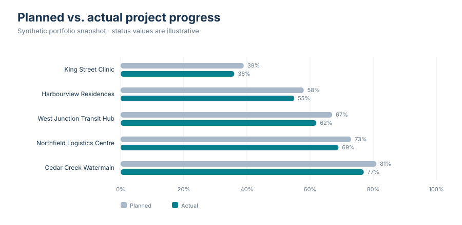
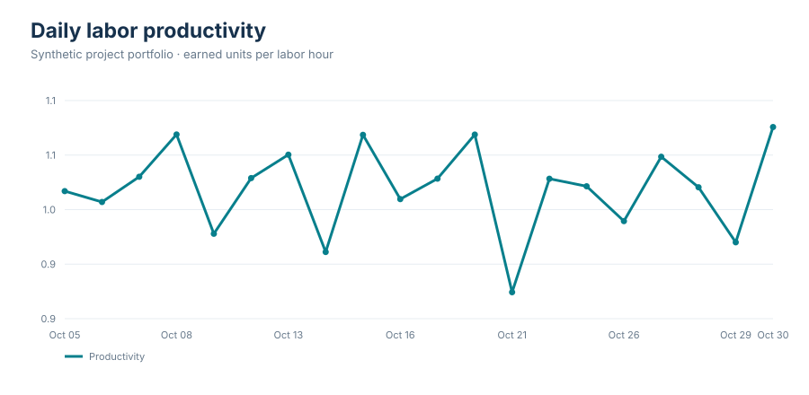
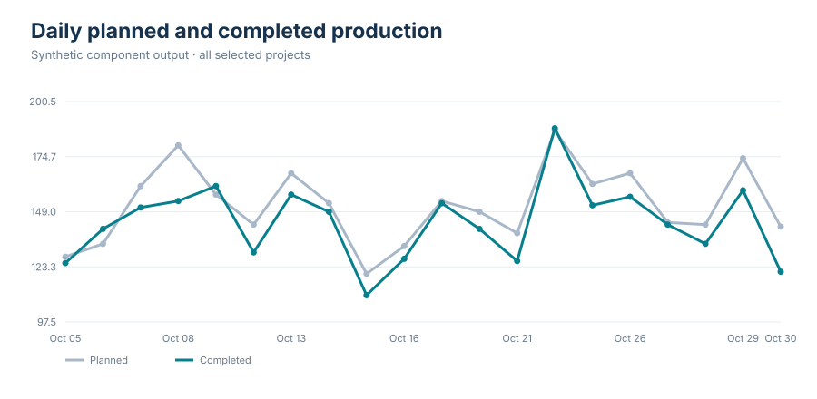

# Industrialized Construction Research & Operations Data Hub

A portfolio MVP for integrating construction project, labor, equipment, production, procurement, and document information into a governed operations view. It uses deterministic synthetic data and includes a Streamlit dashboard, data quality checks, source CSVs, and governance documentation.

## Dashboard graphs

These static exports show every graph in the interactive dashboard. They are regenerated from the same synthetic data used by the app.

### Planned vs. actual project progress



### Daily labor productivity



### Daily production plan vs. completed output



## Run locally

Requires Python 3.10+.

```powershell
python -m venv .venv
.venv\Scripts\Activate.ps1
python -m pip install -r requirements.txt
streamlit run app.py
```

Use the sidebar to filter the sample portfolio. Explore project delivery, labor and equipment indicators, production plan attainment, procurement lead times, and keyword search across sample reports, meeting notes, quality inspections, and change requests. Data Quality exposes validation checks; Governance summarizes ownership and handling expectations.

## Source of the sample data

There is **no connected database or external construction dataset** in this demo. Every row is fictional and is generated deterministically by [`src/demo_data.py`](src/demo_data.py) using a fixed random seed. This keeps the example reproducible and avoids sharing real project, worker, supplier, or document information.

The generator's CSV exports are checked into [`data/demo/`](data/demo/):

| Export | Source table / grain |
|---|---|
| [Projects](data/demo/projects.csv) | One row per synthetic project |
| [Daily labor](data/demo/labor_daily.csv) | One row per project and work date; aggregate hours, earned units, and cost |
| [Daily equipment](data/demo/equipment_daily.csv) | One row per project and work date; active, available, and downtime hours |
| [Daily production](data/demo/production_daily.csv) | One row per project, date, and component type |
| [Procurement orders](data/demo/procurement_orders.csv) | One row per synthetic purchase order |
| [Document excerpts](data/demo/documents.csv) | One row per synthetic report, meeting note, inspection, or change request |

Regenerate the CSVs and README graphs from the project root with `python -m src.export_readme_assets`. See [`data/README.md`](data/README.md) for provenance and field notes. `src/quality.py` checks required fields, uniqueness, valid ranges, and referential integrity before dashboard metrics are calculated.

## Integration scope

For a production integration, replace the demo generator with approved source adapters, preserve source keys and load timestamps, define incremental recovery and reconciliation, and obtain data-owner approval before exposing person-level records. See [`docs/architecture.md`](docs/architecture.md) for a proposed ingestion pattern and [`docs/governance.md`](docs/governance.md) for ownership, sensitivity, access, and retention questions.

## Repository map

- `app.py` — interactive Streamlit dashboard.
- `src/demo_data.py` — repeatable synthetic source datasets.
- `src/export_readme_assets.py` — reproducible CSV and SVG graph exports.
- `src/quality.py` — reusable validation checks.
- `data/demo/` — generated CSV sources used by the dashboard.
- `assets/graphs/` — README-friendly SVG exports of every dashboard graph.
- `docs/` — architecture and governance notes.

## Limitations

All records and targets are simulated for demonstration. Productivity measures are aggregate indicators, not individual performance scores. Schedule variance and cost indicators are simplified examples and must not be used for commercial, safety, labor, or employment decisions.
